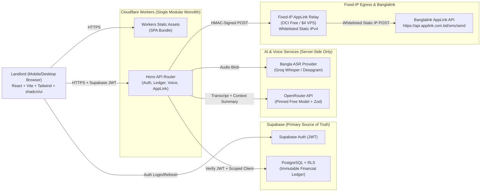

# 08 — System Architecture (Modular Monolith)

**Last Updated:** 2026-11-22  
**Epistemic Legend:** `[Official requirement]` | `[Verified technical fact]` | `[Recommendation]` | `[Assumption]` | `[Unknown]` | `[Unverified]`

---

## 1. High-Level Architecture Diagram



---

## 2. Modular Monolith Repository Layout (Planned)

To keep OpenCode edits clean, deterministic, and testable, organize the repository as a single TypeScript workspace `[Recommendation]`:

```text
rentready-ai/
├── AGENTS.md                       # Mandatory rules for OpenCode & Antigravity
├── docs/
│   ├── planning/                   # 01 through 21 architecture & research docs
│   └── reference/                  # Delegate Booklet v0.0.3 (when provided)
├── apps/
│   ├── web/                        # React + Vite + Tailwind + shadcn/ui SPA
│   │   ├── src/
│   │   │   ├── features/           # auth, properties, tenants, finance, voice, maintenance, dashboard
│   │   │   ├── components/         # Shared UI primitives
│   │   │   ├── lib/                # API client, Supabase auth client, i18n (bn/en)
│   │   │   └── main.tsx
│   └── api/                        # Cloudflare Worker (Hono) + Static Assets config
│       ├── src/
│       │   ├── modules/
│       │   │   ├── properties/
│       │   │   ├── tenants/
│       │   │   ├── ledger/         # Deterministic financial engine (paisa integers)
│       │   │   ├── expenses/
│       │   │   ├── maintenance/
│       │   │   ├── voice/          # ASR adapter + OpenRouter extractor + entity resolver
│       │   │   ├── notifications/  # AppLink client + idempotency + audit logger
│       │   │   └── dashboard/
│       │   ├── middleware/         # JWT auth, Zod validator, rate limiter, error handler
│       │   └── index.ts
│       └── wrangler.jsonc
├── packages/
│   └── shared/                     # Shared Zod schemas, action contracts, money helpers (paisa <-> BDT)
├── services/
│   └── applink-relay/              # Tiny authenticated static-IP relay for AppLink POSTs
└── supabase/
    ├── migrations/                 # Sequential SQL migrations (schema, views, RLS, RPCs)
    └── seed.sql                    # Local dev seed data (never run on production)
```

---

## 3. Core Architectural Invariants

1. **Single Source of Truth:** Supabase PostgreSQL holds all operational, financial, voice-audit, and notification records. No secondary database or client-side financial calculation is authoritative `[Recommendation]`.
2. **User-Scoped DB Execution:** The Worker validates the caller's Supabase JWT and passes the user's JWT to Supabase so **PostgreSQL RLS enforces tenant isolation at the database layer** — never bypass RLS with `service_role` in user-facing routes `[Recommendation]`.
3. **Deterministic Financial Engine:** All payment allocations, outstanding balances, and reversals execute inside PostgreSQL transactions (via SQL RPC functions) using `BIGINT` minor units (`paisa`). Floating-point numbers (`float`, `number` decimals) are strictly banned for money `[Recommendation]`.
4. **Zero-Trust AI Pipeline:** The LLM only proposes a typed JSON intent. The Worker validates it with Zod, resolves entities against the landlord's DB rows, and returns a `proposed_action` requiring explicit user confirmation via `POST /api/voice/actions/:id/confirm` with an `idempotency_key` `[Recommendation]`.
5. **Isolated Telco Egress:** Only `services/applink-relay` holds the AppLink `applicationId` and `password` (or receives them over an authenticated internal channel from the Worker) and sends outbound requests from the single whitelisted static IPv4 address `[Recommendation]`.
6. **Bangladesh Timezone Handling:** Store all timestamps in UTC (`TIMESTAMPTZ`). Compute billing months (`YYYY-MM`) and render UI dates in `Asia/Dhaka` (`UTC+06:00`) `[Recommendation]`.
